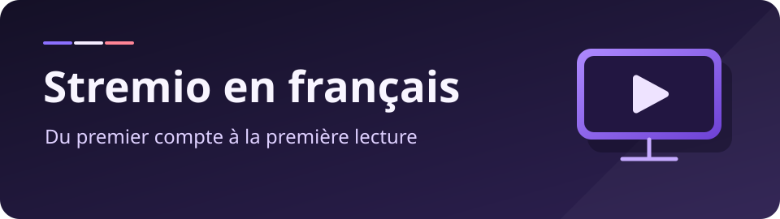

# Stremio en français

Configurez Stremio pour afficher des fiches de films et séries en français et retrouver vos extensions sur les appareils connectés au même compte. Vous pouvez suivre le guide sans avoir jamais installé d’extension.

**Sommaire** · [Installer Stremio](#1-installer-stremio) · [Configurer AIOMetadata](#2-configurer-aiometadata) · [Ajouter TOP Streaming](#3-ajouter-top-streaming-facultatif) · [Configurer Lumio](#4-configurer-lumio) · [Ranger les extensions](#5-ranger-les-extensions-facultatif) · [Tester et dépanner](#6-tester-et-dépanner)

## 1. Installer Stremio

1. Sur un ordinateur, ouvrez [Stremio Web](https://web.stremio.com/) et créez un compte ou connectez-vous à votre compte existant.
2. Gardez cet onglet ouvert. Il vous servira à installer les extensions.
3. Sur l’appareil où vous souhaitez regarder vos vidéos, repérez la version adaptée sur la [page officielle de téléchargement](https://www.stremio.com/downloads). Sur iPhone, suivez le lien **AltStore PAL** de la section **iOS (full version)** si vous souhaitez installer la version complète proposée en France. Sur une TV compatible, cherchez Stremio dans le magasin d’applications du téléviseur.
4. Connectez-vous avec le **même compte Stremio** sur chaque appareil.

Une **extension** (*add-on*) ajoute une fonction à Stremio. **AIOMetadata** fournit des fiches, des affiches et des catalogues. **TOP Streaming** affiche des classements. **Lumio** recherche des sources de lecture. Les classements et les fiches peuvent s’afficher même si aucune source de lecture n’est disponible.

### Installer une extension à partir d’un lien

Cette méthode vous resservira à chaque étape. Le lien d’installation, aussi appelé **URL du manifeste**, se termine généralement par `/manifest.json`.

1. Sur la page de configuration de l’extension, cliquez sur **Installer** si le bouton ouvre Stremio. Vérifiez le nom de l’extension et confirmez dans Stremio.
2. Si le bouton n’ouvre rien, utilisez **Copier le lien d’installation** ou **Copy manifest URL** sur la page de configuration.
3. Dans [Stremio Web → Extensions](https://web.stremio.com/#/addons), cliquez sur **+ Add addon** (*Ajouter une extension*), collez le lien dans la boîte de dialogue et validez. Cliquez ensuite sur **Install** (*Installer*).
4. Dans **My Add-ons** (*Mes extensions*), vérifiez que le nom de l’extension apparaît.

*Page des extensions dans la documentation Stremio. La disposition peut varier selon la version.*

Voir où trouver les extensions sur Android

## 2. Configurer AIOMetadata

### Récupérer votre clé TMDB

[TMDB](https://www.themoviedb.org/) fournit les affiches et les informations sur les films et séries. La **clé API** est la valeur qui autorise l’extension à interroger TMDB.

1. Créez un compte TMDB ou connectez-vous.
2. Ouvrez [Paramètres du compte → API](https://www.themoviedb.org/settings/api) depuis votre ordinateur et suivez la demande de clé.
3. Une fois la demande terminée, copiez la valeur du champ **API Key** (clé v3). Gardez l’onglet ouvert pour la retrouver après l’import.

### Importer la configuration France

1. Ouvrez la [configuration d’AIOMetadata](https://aiometadata.elfhosted.com/configure/) dans un nouvel onglet. Si un assistant de démarrage masque les réglages, passez-le pour accéder à la configuration.
2. Sur GitHub, ouvrez le [fichier de configuration France](aiometadata-config-2026-05-20.json). Cliquez sur **Copy raw file** (*Copier le fichier brut*), l’icône de copie près du bouton **Raw**.
3. Dans AIOMetadata, ouvrez la section **Configuration** si nécessaire et cliquez sur **Import Setup** (*Importer une configuration*). Collez le texte copié et choisissez **Merge** (*Fusionner*) si la fenêtre affiche ce choix. Si elle demande un fichier, téléchargez le JSON depuis GitHub, puis sélectionnez-le.
4. **Après l’import**, ouvrez **Integrations** (*Intégrations*) et collez votre clé dans le champ **TMDB**.
5. Dans **General** (*Général*), vérifiez que la langue est **French (France)**. Dans **Catalogs** (*Catalogues*), vous pouvez activer ou désactiver les listes qui s’afficheront dans Stremio.
6. Cliquez sur **Save Configuration**. Si AIOMetadata vous donne un identifiant de configuration ou vous demande un mot de passe, gardez-les pour modifier vos réglages plus tard.
7. Cliquez sur **Install** ou copiez le lien d’installation et [ajoutez-le dans Stremio Web](#installer-une-extension-à-partir-dun-lien).

> [!TIP]
> Si l’import échoue, vous pouvez configurer AIOMetadata à la main. Renseignez la clé TMDB dans **Integrations**, choisissez **French (France)** dans **General**, puis activez les listes qui vous intéressent dans **Catalogs** avant d’enregistrer.

**À vérifier** · AIOMetadata apparaît dans **Mes extensions**. Ouvrez une fiche depuis un catalogue AIOMetadata pour vérifier qu’une description française est disponible.

## 3. Ajouter TOP Streaming (facultatif)

TOP Streaming affiche les titres populaires par plateforme. Pour retrouver les classements de Netflix, Prime Video ou Disney+ en France, ouvrez [TOP Streaming](https://top-streaming.stream/), cliquez sur le bouton de configuration et sélectionnez **France** ainsi que les plateformes de votre choix. Installez ensuite l’extension via son bouton d’installation ou [avec son lien](#installer-une-extension-à-partir-dun-lien).

**À vérifier** · Les classements sélectionnés apparaissent à l’accueil après actualisation.

## 4. Configurer Lumio

### Choisir un débrideur

Un **débrideur** est un service tiers que Lumio peut utiliser pour accéder à des fichiers. Cette étape sert à la recherche de sources par Lumio. Vous pouvez déjà explorer les catalogues AIOMetadata sans compte chez un débrideur.

1. Ouvrez [Lumio](https://mylumio.tv/configure) et regardez quels fournisseurs sont proposés avant de choisir un abonnement. **Un seul fournisseur suffit** pour ce guide.
2. Si vous choisissez **AllDebrid**, connectez-vous et ouvrez [Mes clés API](https://alldebrid.com/apikeys/). Créez une clé nommée `Lumio` et copiez-la.
3. Si vous choisissez **TorBox** et qu’il figure dans votre version de Lumio, ouvrez [TorBox → Settings](https://torbox.app/settings), repérez **API Key** et cliquez sur **Copy API Key**.

Voir la [capture des paramètres TorBox](https://guides.viren070.me/stremio/faq#where-can-i-find-my-debrid-api-key) si vous cherchez le bouton de copie.

### Installer le profil Lumio

1. Dans Lumio, donnez un nom à votre profil, par exemple **Salon**.
2. Sélectionnez votre fournisseur et suivez la méthode de connexion affichée. Si Lumio demande une clé API, collez celle du fournisseur sélectionné.
3. Choisissez le style de présentation des résultats, puis cliquez sur **Activer dans Stremio**.
4. Confirmez l’installation dans Stremio. Si Stremio ne s’ouvre pas, utilisez le bouton de copie du lien dans Lumio et [installez l’extension via Stremio Web](#installer-une-extension-à-partir-dun-lien).

> [!IMPORTANT]
> Gardez vos clés API et liens d’installation privés. Avant de partager une capture, masquez vos clés, l’URL d’installation et vos identifiants.

**À vérifier** · Lumio figure dans **Mes extensions**. Ouvrez un titre que vous avez le droit de visionner et cherchez la rubrique **Lumio** dans la liste des sources.

## 5. Ranger les extensions (facultatif)

Pour retrouver les catalogues français plus haut dans Stremio, ouvrez [Stremio Addon Manager](https://stremio-addon-manager.vercel.app/). C’est un outil tiers. Cette étape est facultative et vous pouvez passer directement au test.

1. Chargez la liste des extensions de votre compte en suivant les indications de l’outil.
2. Faites glisser les extensions dans cet ordre si elles sont présentes.

   | Ordre | Extension |
   | --- | --- |
   | 1 | AIOMetadata · ElfHosted |
   | 2 | TOP Streaming, si installé |
   | 3 | Lumio |
   | 4 | Cinemeta, l’extension de catalogue incluse dans Stremio |
   | 5 | Vos autres extensions |

3. Enregistrez le nouvel ordre, puis actualisez Stremio. Sur une TV, fermez et rouvrez l’application pour recharger la liste.

## 6. Tester et dépanner

1. Depuis l’accueil, ouvrez une fiche via un catalogue AIOMetadata et vérifiez la langue de la description.
2. Ouvrez un film ou sélectionnez un épisode que vous avez le droit de visionner. Si Lumio propose une source, lancez-la et vérifiez la piste audio dans le lecteur. Une fiche en français et une piste audio française se règlent séparément.
3. Ouvrez Stremio sur votre appareil principal avec le même compte et vérifiez que vos extensions y figurent.

| Si vous voyez… | Essayez ceci |
| --- | --- |
| Le bouton **Installer** ne fait rien | Copiez le lien d’installation depuis l’extension, puis utilisez **+ Add addon** dans Stremio Web. |
| AIOMetadata manque ou ses fiches restent en anglais | Ouvrez une fiche depuis un catalogue AIOMetadata. Vérifiez ensuite **French (France)** et la clé TMDB après l’import, puis enregistrez. Si la configuration a généré un nouveau lien, installez-le. |
| Lumio est installé, mais aucune source ne s’affiche | Vérifiez le fournisseur choisi, sa connexion et l’état de votre offre. Essayez un autre titre que vous pouvez visionner pour voir si le souci touche un seul titre. |
| Les extensions sont visibles sur l’ordinateur, mais pas sur la TV | Vérifiez l’adresse du compte sur les deux appareils, puis quittez et relancez Stremio sur la TV. |
| Deux catalogues se ressemblent | Vérifiez le nom de l’extension sous chaque catalogue. Ajustez les catalogues activés dans AIOMetadata ou [l’ordre des extensions](#5-ranger-les-extensions-facultatif). |

**Documentation** · [Stremio — gérer les extensions](https://stremio.zendesk.com/hc/en-us/articles/360021348391-How-to-install-uninstall-Add-ons) · [ElfHosted — AIOMetadata](https://docs.elfhosted.com/app/aiometadata/) · [TMDB — obtenir une clé API](https://developer.themoviedb.org/docs/getting-started)
