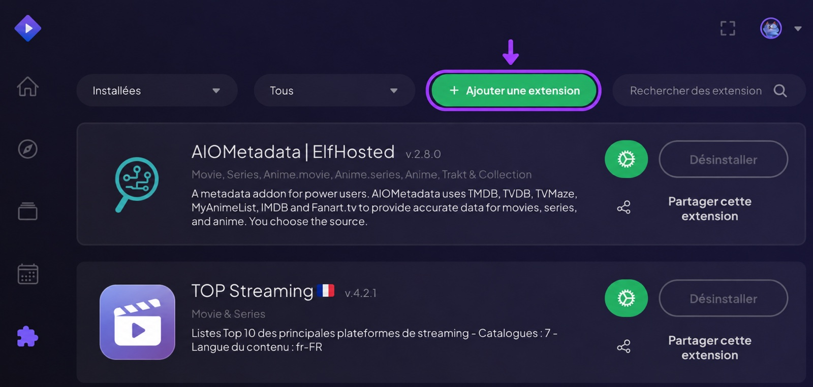

# Stremio en français


Ce guide vous aide à installer Stremio, à afficher des fiches en français et à configurer vos extensions. Faites la configuration dans un navigateur sur ordinateur, puis utilisez le même compte Stremio sur votre téléphone ou votre TV.

**Sommaire** · [Compte Stremio](#1-créer-un-compte-stremio) · [Compte débrideur](#2-créer-un-compte-torbox-ou-alldebrid) · [AIOMetadata](#3-mettre-les-fiches-en-français-avec-aiometadata) · [TOP Streaming](#4-ajouter-top-streaming-facultatif) · [Lumio](#5-configurer-lumio) · [Ordre des extensions](#6-ranger-les-extensions) · [Dépannage](#7-tester-et-dépanner)

## 1. Créer un compte Stremio

1. Ouvrez [Stremio Web](https://web.stremio.com/) et créez un compte ou connectez-vous.
2. Installez Stremio sur l’appareil où vous regarderez vos vidéos. Choisissez votre appareil sur la [page de téléchargement officielle](https://www.stremio.com/downloads). Sur une TV compatible, cherchez **Stremio** dans le magasin d’applications.
3. Utilisez le **même compte Stremio** sur tous vos appareils pour retrouver vos extensions.

## 2. Créer un compte TorBox ou AllDebrid

Un débrideur est le service que vous associerez à Lumio pour obtenir des liens de lecture. **Un seul compte suffit.**

| Service | Peut-on l’utiliser dans plusieurs foyers en même temps ? |
| --- | --- |
| [TorBox](https://www.torbox.app/subscription?referral=3f98b0bb-0ac6-4108-a932-54d1853f1f4b) | **Oui.** Un même abonnement peut être utilisé simultanément sur plusieurs connexions Internet, donc à plusieurs adresses IP. TorBox applique une [règle d’usage raisonnable](https://support.torbox.app/en/articles/9836406-can-i-use-my-account-with-many-different-ip-s). |
| [AllDebrid](https://alldebrid.fr/) | **Prévoyez un abonnement distinct par foyer.** Le compte est réservé à [un usage personnel](https://alldebrid.fr/tos/). Pour un usage résidentiel, comptez [une adresse IP publique à la fois](https://guides.viren070.me/stremio/faq#how-does-the-one-ip-address-rule-work). |

Avec mon lien de parrainage, vous recevez **7 jours offerts par mois acheté** lors de votre premier achat. Je reçois aussi un bonus.

| Premier abonnement | Jours offerts | Durée totale |
| --- | --- | --- |
| 1 mois | 7 jours | 1 mois + 7 jours |
| **1 an** | **84 jours** | **12 mois + 84 jours**, soit environ **14 mois et 3 semaines** |

**Le bonus s’applique au premier achat uniquement.** Si vous commencez par un mois puis passez à un an, vous aurez les 7 jours offerts du premier mois. Pour obtenir les 84 jours offerts, choisissez l’abonnement annuel dès le départ. [Conditions du parrainage TorBox](https://support.torbox.app/en/articles/9875657-how-does-the-torbox-referral-system-work)

**Code de parrainage TorBox à copier** · `3f98b0bb-0ac6-4108-a932-54d1853f1f4b`

## 3. Mettre les fiches en français avec AIOMetadata

AIOMetadata fournit les fiches, affiches et catalogues de films et de séries. Il utilise une clé API TMDB, un code qui lui donne accès à ces informations.

1. Ouvrez [AIOMetadata → Configuration](https://aiometadata.elfhosted.com/configure/#configuration). En bas à droite de la page, repérez le bloc **Import Configuration**. Collez cette adresse dans **Configuration URL**, puis cliquez sur **Fetch**.

   ```text
   https://raw.githubusercontent.com/valentinBoch/Stremio-France-Config/refs/heads/main/aiometadata-config-2026-11-15.json
   ```

   Si **Fetch** affiche une erreur, ouvrez le [JSON brut](https://raw.githubusercontent.com/valentinBoch/Stremio-France-Config/refs/heads/main/aiometadata-config-2026-11-15.json), enregistrez-le sur votre appareil, puis sélectionnez-le avec le bouton **Import Configuration** sur la même page.

2. Créez un compte [TMDB](https://www.themoviedb.org/), puis récupérez votre **API Key** (v3) dans [Paramètres → API](https://www.themoviedb.org/settings/api). Collez-la dans **Integrations → TMDB**. La configuration importée règle déjà la langue sur **French (France)**.
3. Cliquez sur **Save Configuration**, puis copiez le lien d’installation. Ouvrez [Stremio Web → Extensions](https://web.stremio.com/#/addons), cliquez sur **+ Ajouter une extension**, collez le lien et confirmez avec **Installer**.



**À vérifier** · Dans le filtre en haut à gauche, choisissez **Installées**. AIOMetadata doit apparaître dans la liste. Ouvrez une fiche depuis un de ses catalogues et vérifiez que la description s’affiche en français quand une traduction est disponible.

## 4. Ajouter TOP Streaming (facultatif)

TOP Streaming ajoute les classements de Netflix, Prime Video et d’autres plateformes à l’accueil.

1. Ouvrez [TOP Streaming](https://top-streaming.stream/), cliquez sur le bouton de configuration, puis choisissez **France** et les plateformes qui vous intéressent.
2. Copiez le lien d’installation. Dans [Stremio Web → Extensions](https://web.stremio.com/#/addons), cliquez sur **+ Ajouter une extension**, collez le lien et confirmez avec **Installer**.

## 5. Configurer Lumio

1. Ouvrez [Lumio](https://mylumio.tv/configure) et donnez un nom à votre profil, par exemple **Salon**.
2. Sélectionnez le service choisi à l’étape 2. Si Lumio vous demande une clé API, récupérez-la dans les réglages de ce service.

   | Service | Où trouver la clé |
   | --- | --- |
   | TorBox | Dans [Settings](https://torbox.app/settings), cliquez sur **Copy API Key**. |
   | AllDebrid | Dans [Mes clés API](https://alldebrid.com/apikeys/), créez une clé nommée **Lumio**, puis copiez-la. |

3. Suivez les indications de Lumio pour connecter le service. Choisissez la présentation des résultats, puis cliquez sur **Activer dans Stremio** et confirmez l’installation.
4. Si Stremio ne s’ouvre pas, copiez le lien d’installation depuis Lumio. Dans [Stremio Web → Extensions](https://web.stremio.com/#/addons), cliquez sur **+ Ajouter une extension**, collez le lien et confirmez avec **Installer**.

## 6. Ranger les extensions

Ouvrez [Stremio Addon Manager](https://stremio-addon-manager.vercel.app/), un outil tiers, puis chargez la liste des extensions de votre compte. Faites-les glisser dans cet ordre, enregistrez et actualisez Stremio.

1. **AIOMetadata · ElfHosted**
2. **TOP Streaming**, si installé
3. **Lumio**
4. **Cinemeta**, le catalogue inclus avec Stremio
5. Vos autres extensions

## 7. Tester et dépanner

Ouvrez un titre que vous avez le droit de visionner et cherchez **Lumio** dans les sources. Une fois la vidéo lancée, utilisez le menu audio du lecteur pour choisir le français si une piste est disponible.

| Problème | Quoi faire |
| --- | --- |
| Le lien d’installation ne s’ouvre pas | Copiez le lien fourni par l’extension, puis utilisez le bouton **+ Ajouter une extension** dans [Stremio Web → Extensions](https://web.stremio.com/#/addons). |
| Les fiches restent en anglais | Ouvrez une fiche depuis un catalogue **AIOMetadata**. Vérifiez **French (France)** et la clé TMDB dans AIOMetadata, puis enregistrez. |
| Lumio ne propose aucune source | Vérifiez la connexion à votre débrideur, puis essayez un autre titre auquel vous avez accès. |
| Les extensions manquent sur la TV | Vérifiez que vous utilisez le même compte Stremio, puis fermez et rouvrez l’application. |
